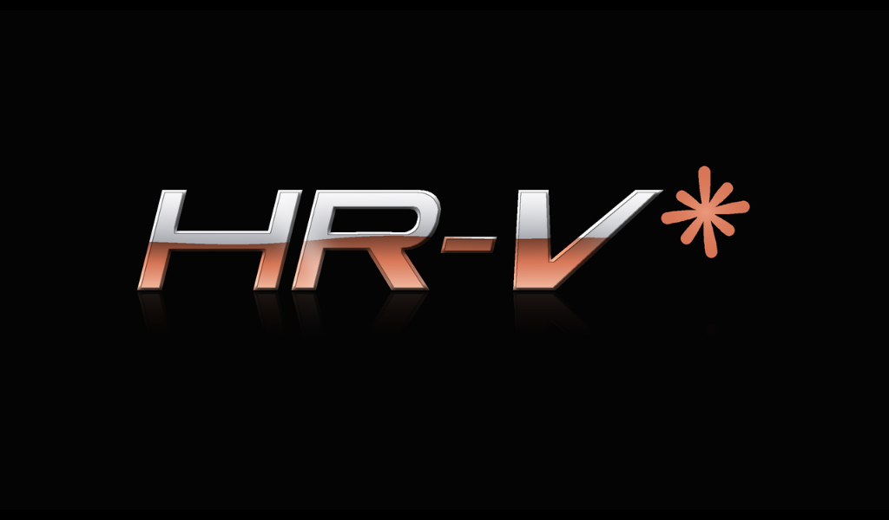
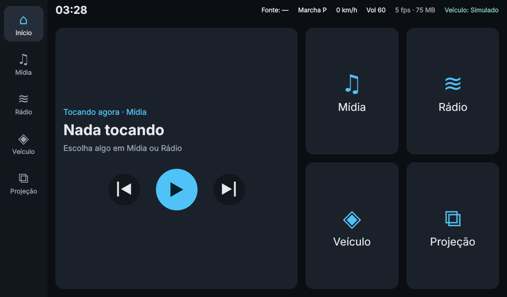
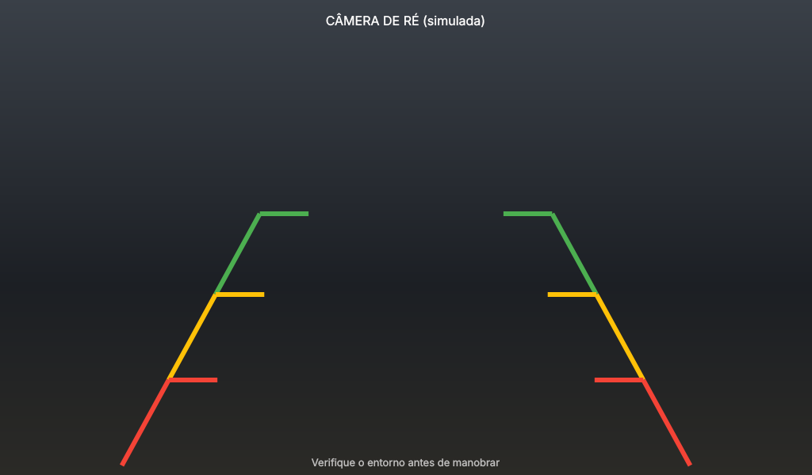
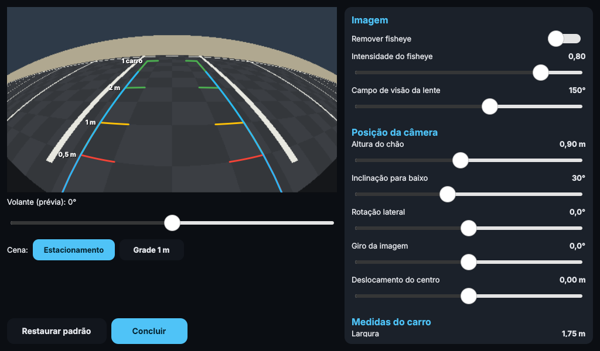
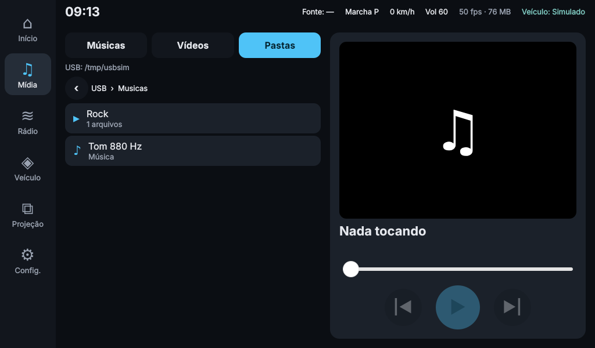
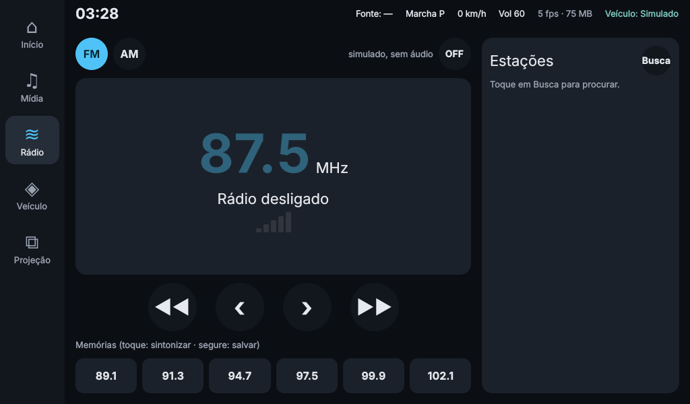

# headunit-linux

Software para central multimídia automotiva com **sistema próprio**: Linux enxuto +
interface em **Qt 6 / QML**. A ideia é substituir o Android da central por algo leve,
com boot rápido. Durante o desenvolvimento, tudo roda no **PC (Windows ou Linux)**,
com o hardware do carro simulado.

> Projeto irmão: [`headunit-android`](https://github.com/PedroHTF/headunit-android),
> o caminho mantendo o Android (e o Zlink).

| Logo de inicialização | Início |
|---|---|
|  |  |
| **Câmera de ré (volante virado)** | **Ajuste da câmera de ré** |
|  |  |
| **Mídia → Pastas** | **Rádio** |
|  |  |

## O que já funciona

| Função | Situação |
|---|---|
| Músicas e vídeos do "pendrive" (uma pasta no PC), atualizando sozinho | ✅ real (QtMultimedia) |
| Navegação por **pastas** do pendrive | ✅ Mídia → Pastas ([como organizar](docs/pendrive.md)) |
| **Logo de inicialização** animado, trocável por imagem/vídeo do pendrive | ✅ Configurações → Logo |
| Vídeo oculto com o carro em movimento (> 5 km/h), desativável em Configurações | ✅ |
| Rádio FM/AM: sintonia, busca, memórias, RDS, lista de estações | 🟡 simulado (sem áudio) |
| Ignição/ACC, marcha, velocidade, ângulo do volante | 🟡 simulados (janela "Simulador") |
| Câmera de ré automática ao engatar a ré | 🟡 imagem simulada (cena gerada pelo modelo da câmera) |
| Linhas em metros e em "carros", trajetória pelo volante, remoção do fisheye, calibração | ✅ Configurações → Ajustar câmera de ré |
| Tela apagada e áudio parado com ACC desligado | ✅ |
| Botões do volante (próxima, anterior, play, volume, mudo, fonte) | ✅ simulador e teclado |
| Métricas: tempo até o 1º quadro, FPS, memória | ✅ |
| CarPlay / Android Auto | ⏳ planejado via dongle USB |
| **Telefone** (agenda, recentes, teclado, chamada recebida/ativa, botão do volante) | 🟡 simulado; real via oFono/BlueZ (HFP) e obexd (PBAP) |
| **Equalizador** 10 bandas, predefinições, balanço, fader, loudness | 🟡 salvo e exibido; o som será processado pelo DSP da central |

## Rodar no Windows

**Jeito rápido (sem instalar nada):** aba **Actions** do GitHub → execução mais recente →
**Artifacts** → `headunit-windows` → descompacte e rode `headunit.exe`.

**Para desenvolver:** siga **[docs/setup-windows.md](docs/setup-windows.md)** (Qt Creator).

Ao abrir, aparecem duas janelas:
- **HeadUnit** (1024×600): a tela da central.
- **Simulador**: ignição, marcha, velocidade, volante, pendrive e desempenho.

Coloque músicas/vídeos na pasta `HeadUnitUSB` dentro da sua pasta de usuário
(ex.: `C:\Users\voce\HeadUnitUSB`). A lista atualiza sozinha.

### Opções de linha de comando

```
headunit --media D:\Musicas     pasta que simula o pendrive
headunit --fullscreen           tela cheia, como na central
headunit --no-simulator         sem a janela do simulador
headunit --page 3               abre direto numa tela (0 Início, 1 Mídia, 2 Rádio, 3 Telefone, 4 Veículo, 5 Projeção, 6 Configurações)
headunit --call incoming        simula uma ligação chegando (ou --call active)
headunit --equalizer            abre direto o equalizador
headunit --screenshot tela.png  salva uma captura e sai (sem o logo; --splash para incluí-lo)
headunit --gear R --steering 200   começa de ré com o volante virado
headunit --camera-setup         abre direto o ajuste da câmera de ré
```

### Atalhos de teclado (janela principal)

`R` ré · `←`/`→` volante · `T` telefone (atende/desliga) · `N` próxima · `B` anterior · `Espaço` play/pause · `F` fonte (mídia/rádio) ·
`+`/`-` volume · `M` mudo

## Arquitetura

```
qml/                  Interface (telas, componentes, janela do simulador)
src/app/              AppController: fonte de áudio ativa, volante, ACC, regras
src/media/            MediaLibrary (lista do pendrive) + MediaPlayerController
src/hal/              Camada de hardware (HAL): a única parte que muda do PC para a central
  VehicleHal            ← SimulatedVehicleHal | (futuro) McuVehicleHal / SocketCAN
  RadioHal              ← SimulatedRadioHal  | (futuro) chip de rádio via MCU, RTL-SDR
  DrivingRules          regras de segurança (vídeo em movimento, câmera de ré)
src/perf/             PerfMonitor: 1º quadro, FPS, memória
src/camera/           Câmera de ré: geometria em C++ puro (lente/fisheye, linhas, trajetória,
                      cena simulada), CameraSettings e o item QML ReverseCamera
src/logo/             LogoManager: logo padrão ou arquivo do pendrive
tests/                Testes (Qt Test): rádio, regras/controle, biblioteca de mídia
```

A montagem fica em `src/main.cpp`: na central, basta trocar `SimulatedVehicleHal` e
`SimulatedRadioHal` pelas implementações reais. A interface e o resto não mudam.

## Compilar pela linha de comando

```bash
cmake -S . -B build -G Ninja -DCMAKE_BUILD_TYPE=Release
cmake --build build
ctest --test-dir build --output-on-failure
./build/headunit
```

Linux (Ubuntu 24.04): `sudo apt install qt6-base-dev qt6-declarative-dev qt6-multimedia-dev
qml6-module-qtquick-controls qml6-module-qtquick-layouts qml6-module-qtmultimedia
gstreamer1.0-plugins-good gstreamer1.0-libav cmake ninja-build`.

Requer Qt **6.4 ou mais novo** (recomendado 6.8 LTS).

## Câmera de ré

Em **Configurações → Ajustar câmera de ré**, com prévia ao vivo: medidas do carro (largura,
comprimento usado nas marcas "1 carro/2 carros", entre-eixos, eixo traseiro → para-choque,
relação de direção), posição da câmera (altura, inclinação, rotação, giro, deslocamento),
fisheye (intensidade, campo de visão, remover) e linhas (marcas em metros e em carros,
trajetória pelo volante, ajustes finos). Use a cena **Grade 1 m** para calibrar.

A geometria é a mesma do `headunit-android` (`core/camera`), portada para C++.

## Desempenho

Veja **[docs/desempenho.md](docs/desempenho.md)**: como medir e como limitar CPU/memória
no PC para se aproximar da central.

## Próximos passos

1. Identificar o hardware da central (SoC, MCU, rádio) e decidir a viabilidade do Linux nela.
2. `McuVehicleHal`: protocolo serial do MCU (ACC, ré, volante, CAN).
3. Rádio real (chip da central) e, no PC, opcionalmente RTL-SDR.
4. CarPlay/Android Auto via dongle USB.
5. Bluetooth: chamadas, agenda e música.
6. Imagem do sistema (Buildroot/Yocto) com boot rápido e sistema de arquivos somente leitura.
