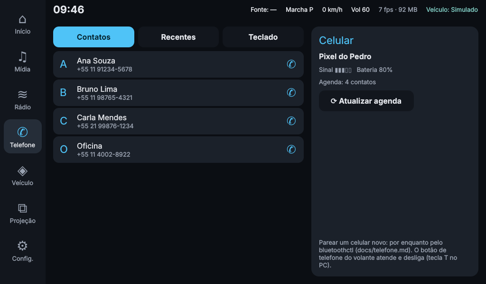

# Telefone pelo Bluetooth (Linux)

A central funciona como **viva-voz** do celular (Bluetooth HFP, papel *Hands-Free*):
o celular faz a ligação; a central mostra quem liga, atende, desliga, mostra a agenda
e o histórico. Quem faz o trabalho pesado são os serviços padrão do Linux:

| Peça | O que faz | Onde fala com o app |
|---|---|---|
| **BlueZ** (`bluetoothd`) | Bluetooth em si: pareamento, conexão | (pelo oFono) |
| **oFono** (`ofonod`) | Protocolo HFP: chamadas, sinal, bateria, mudo, DTMF | D-Bus do **sistema**, `org.ofono` |
| **obexd** (do BlueZ) | PBAP: baixa agenda e histórico de chamadas | D-Bus de **sessão**, `org.bluez.obex` |
| **PipeWire + WirePlumber** | Áudio da chamada (SCO): voz do celular → alto-falantes, microfone → celular | (fora do app) |

No app: `src/hal/OfonoPhoneHal` (chamadas), `src/hal/PbapClient` (agenda) e
`src/hal/VCard` (leitura dos vCards). A tela é a mesma do telefone simulado.

| Celular conectado (agenda pelo PBAP) | Chamada recebida |
|---|---|
|  |  |

(Capturas com oFono/obexd simulados; ver "Testes sem Bluetooth".)

> **Situação:** testado contra um oFono e um obexd **simulados** (`tests/tst_ofono.cpp`),
> que imitam a API D-Bus real. **Ainda não foi testado com um celular de verdade.**
> O áudio da chamada (última seção) é a parte que mais deve precisar de ajuste.

## Qual telefone o app usa

```
headunit --phone auto    # padrão: oFono se ele existir no sistema; senão, o simulado
headunit --phone ofono   # força o real (fica "Nenhum celular conectado" se o oFono não estiver rodando)
headunit --phone sim     # força o simulado
```

Também vale a variável `HEADUNIT_PHONE=ofono|sim`. No Windows só existe o simulado.
O app escreve no terminal qual escolheu (`Telefone: Bluetooth (oFono)`).

## Montar no Linux (central ou PC de teste)

Dá para testar num **PC com Linux e Bluetooth** antes de ir para o carro (pode ser um
pendrive com Ubuntu "live"): o comportamento é o mesmo.

1. Pacotes (Debian/Ubuntu):
   ```bash
   sudo apt install bluez bluez-obexd ofono pipewire wireplumber libspa-0.2-bluetooth
   ```
2. **Áudio HFP pelo oFono.** O PipeWire tem que usar o oFono para o HFP (por padrão usa
   o próprio, que briga com o oFono). WirePlumber 0.5 — crie
   `~/.config/wireplumber/wireplumber.conf.d/51-hfp-ofono.conf`:
   ```
   monitor.bluez.properties = {
     bluez5.hfphsp-backend = "ofono"
   }
   ```
   (WirePlumber 0.4, arquivo `~/.config/wireplumber/bluetooth.lua.d/51-ofono.lua`:
   `bluez_monitor.properties["bluez5.hfphsp-backend"] = "ofono"`.)
   Depois: `systemctl --user restart wireplumber pipewire`.
3. Serviços: `sudo systemctl enable --now bluetooth ofono` e, na sessão do usuário que roda o
   app, o obexd (`systemctl --user start obex` — em muitas distribuições ele sobe sozinho).
4. **Parear o celular** (por enquanto pelo terminal; uma tela de pareamento no app é o próximo passo):
   ```
   bluetoothctl
   power on
   agent on
   default-agent
   pairable on
   discoverable on
   ```
   No celular, procure a central e pareie; confirme o código nos dois lados. Depois:
   `trust AA:BB:CC:DD:EE:FF` (endereço do celular) para ele reconectar sozinho.
5. Abra o app. Ao conectar, o celular pergunta se permite acesso aos **contatos** e ao
   **histórico de chamadas**: permita. A agenda aparece em alguns segundos
   (botão **Atualizar agenda** na tela Telefone para baixar de novo).

## O que o app faz

- Escolhe o celular conectado (se houver vários pareados, prefere o que está conectado) e,
  se nenhum estiver, pede ao oFono para conectar o primeiro.
- Chamada recebida: tela de atender/recusar, com o nome da agenda. O botão de telefone do
  volante atende e desliga. Chamada em espera (chegando durante outra) também aparece;
  atender põe a atual em espera.
- Durante a chamada: mudo (microfone), teclado para menus de atendimento (DTMF), tempo.
- A mídia pausa durante a ligação e volta depois (como no simulado).
- Histórico: o do celular (últimas 50, pelo PBAP) mais as chamadas desta viagem.

## Áudio da chamada (a confirmar no carro)

Com o backend oFono, o PipeWire cria, durante a chamada, uma placa `bluez_card...` com perfil
HFP: uma **saída** (o que vai para o celular = microfone da central) e uma **entrada** (a voz de
quem está do outro lado). Falta ligá-las aos alto-falantes e ao microfone da central.
Para testar à mão durante uma ligação:

```bash
pw-cli ls Node | grep -i bluez         # descobre os nomes dos nós bluez_input/bluez_output
pw-loopback --capture-props='node.target=<bluez_input...>'           # voz do celular -> alto-falantes
pw-loopback --playback-props='node.target=<bluez_output...>'         # microfone -> celular
```

Quando soubermos os nomes certos na central, isso vira configuração fixa do WirePlumber
(ou o app passa a fazer sozinho). Se o outro lado ouvir eco, o PipeWire tem cancelamento de
eco (`libpipewire-module-echo-cancel`).

## Problemas comuns

- **"Nenhum celular conectado" com o celular pareado:** veja se o oFono enxerga o aparelho:
  ```bash
  dbus-send --system --print-reply --dest=org.ofono / org.ofono.Manager.GetModems
  ```
  Deve aparecer `/hfp/org/bluez/hci0/dev_...` com `Powered` verdadeiro. Se não aparecer,
  o PipeWire provavelmente está com o HFP (passo 2).
- **Agenda vazia / "Agenda indisponível":** permita o acesso no celular (no Android:
  Configurações → Bluetooth → aparelho → *Contatos e histórico de chamadas*) e toque em
  **Atualizar agenda**. Confira se o obexd está na sessão do usuário:
  `busctl --user list | grep obex`.
- O app escreve os erros do oFono/PBAP no terminal (`oFono Dial falhou: ...`, `PBAP: ...`).

## Testes sem Bluetooth

```bash
ctest --test-dir build -R 'tst_vcard|tst_ofono' --output-on-failure
```

`tst_ofono` roda dentro de um D-Bus próprio (`dbus-run-session`) com oFono e obexd falsos:
conexão, bateria/sinal, agenda e histórico, chamada recebida/atendida/perdida, ligação feita,
chamada em espera, mudo, DTMF e desconexão. `tst_vcard` cobre os formatos de vCard que os
celulares mandam (2.1 com acentos em QUOTED-PRINTABLE, 3.0, linhas dobradas, histórico).

Para ver a tela com um celular "falso" conectado (capturas de tela):

```bash
dbus-run-session -- bash -c '
  export DBUS_SYSTEM_BUS_ADDRESS=$DBUS_SESSION_BUS_ADDRESS
  HEADUNIT_FAKE_OFONO_SECONDS=30 build/tst_ofono serveFakesForScreenshots &
  sleep 1; build/headunit --phone ofono --page 3'
```
(`HEADUNIT_FAKE_OFONO_CALL=1` faz chegar uma ligação.)
